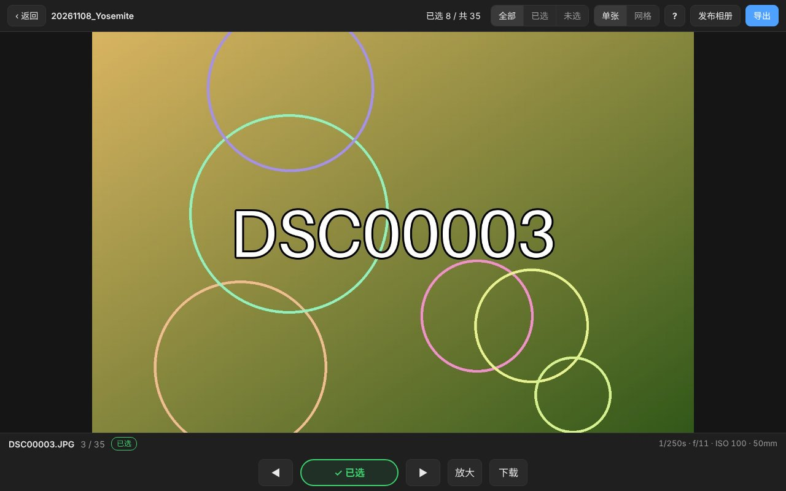
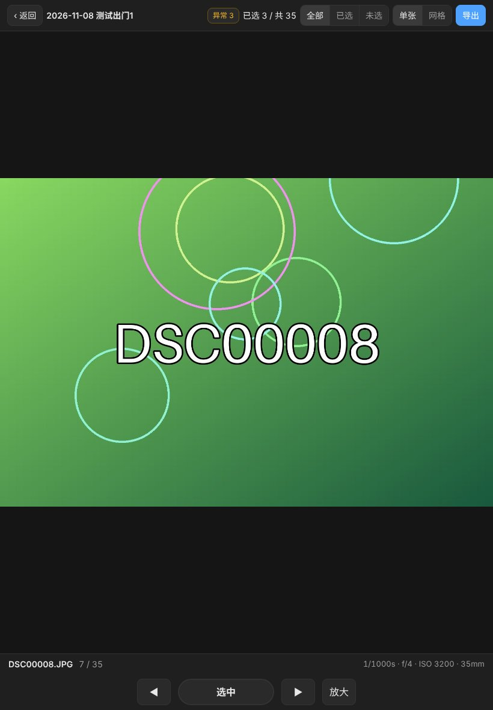

# rawpick

RAW+JPG 照片快速粗筛：用 JPG 预览挑片，自动把选中照片对应的 RAW 拷到 `select/`。
自托管 Web 应用，部署在 Unraid 上，电脑和 iPad 的浏览器都能用。



## 为什么做这个

相机同时拍 RAW 和 JPG、分别存在 `jpg/` 和 `raw/` 两个目录时，Lightroom 会把它们当成两张不同的照片，
没法“用 JPG 挑、再带出对应的 RAW”。rawpick 只做这一件事：

1. 用相机直出的 JPG 快速翻看、标记“选 / 不选”；
2. 按文件名把选中照片的 RAW 拷到 `<出门目录>/select/`，交给后期软件。

## 功能

- **翻页无等待**：服务器预先生成 2560px 预览，浏览器提前下载并解码前后几张。
- **键盘或触屏操作**：`P` 选中、`X` 取消，标记后自动跳到下一张；iPad 上左右滑动、点大按钮。
- **二次筛选**：可以只看已选或只看未选。改了状态的照片先变灰留在原位，切换过滤器时才移走。
- **100% 查焦**：按 `Z`、单击或双指张开，加载原图 JPG。
- **进度跨设备共享**：标记和当前位置都存在服务器上，电脑上筛一半可以在 iPad 上接着筛。
- **导出只增不删**：重复导出会跳过已存在的文件，同名不同大小的不覆盖，后来取消选中的也不删除，只提示你。
- **源文件只读**：照片目录里唯一会被写入的地方是 `select/`。

| 网格视图 | 导出面板 | iPad |
| --- | --- | --- |
|  |  |  |

## 目录约定

```
<照片根目录>/
  <出门目录>/
    jpg/      DSC01234.JPG …
    raw/      DSC01234.ARW …
    select/   rawpick 创建，只放选中的 RAW
```

照片根目录下每个同时含有 `jpg/` 和 `raw/` 的一级子目录算一次出门。JPG 和 RAW 按文件名主体配对，大小写不敏感。

## 快速部署（Unraid）

1. 把这个仓库放到 Unraid 的某个共享里，比如在 Windows 上用 GitHub Desktop clone 到映射的网络盘。
2. 复制配置文件，然后改 `PHOTO_ROOT`：
   ```bash
   cp deploy.env.example deploy.env
   ```
3. 在 Unraid 网页右上角的终端（`>_`）里构建镜像，同时安装 Unraid 模板：
   ```bash
   cd /mnt/user/<共享>/rawpick
   bash deploy.sh --build-only
   ```
4. 在 Docker 页面点 **Add Container**，**Template** 选 **rawpick**，确认后点 **Apply**。
5. 在浏览器里打开 `http://<Unraid IP>:8080`。

不想用 Unraid 模板的话，也可以直接运行 `bash deploy.sh`，一条命令完成构建和启动。
两种方式的区别、更新方法和常见问题见 [部署指南](docs/deployment.md)。

## 快捷键

| 操作 | 键盘 | 触屏 |
| --- | --- | --- |
| 上一张 / 下一张 | `←` / `→` | 左右滑动 |
| 选中 / 取消（标记后自动跳到下一张） | `P` / `X` | 底部大按钮 |
| 100% 放大查焦 | `Z`，或单击图片 | 双指张开、双击 |
| 网格 / 单张 | `G` / `E` | 顶栏按钮 |

更多操作细节见 [使用说明](docs/usage.md)。

## 文档

- [使用说明](docs/usage.md)：界面、过滤、二次筛选、导出规则
- [部署指南](docs/deployment.md)：Unraid 部署、更新、配置项、排错
- [设计文档](docs/design.md)：架构、配对规则、预览与预加载、安全设计、数据模型、API
- [开发指南](docs/development.md)：本地运行、项目结构、测试

## 技术栈

Python 3.13 · Starlette · Uvicorn · Pillow · SQLite · TypeScript（只用 `tsc` 编译，不用框架）· Docker
