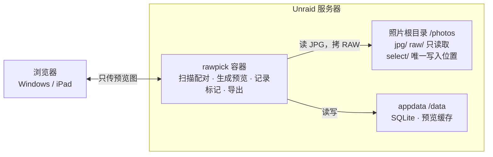

# 设计文档

## 1. 背景与目标

做一个自用的 Web 工具：用相机直出的 JPG 快速粗筛，再把选中照片对应的 RAW 拷到 `<出门目录>/select/`。

- **现状**：每次出门拍几百到 1–2 千张。每张照片有 JPG 和 RAW 两份，分别存在 `jpg/` 和 `raw/` 两个目录。
  Lightroom 会把它们当成两张不同的照片，没法用 JPG 挑、再带出对应的 RAW。
- **目标**
  - 用 JPG 预览和挑选，翻页无等待；
  - 一键把选中照片的 RAW 拷到 `select/`；
  - 在 Windows 浏览器和 iPad 上都能筛，进度两边共享。
- **非目标**：不做后期处理，不渲染 RAW，不改动、不删除任何源文件。

## 2. 运行形态与架构

采用 Unraid 上的 Docker Web 服务，因为只有它能同时在 Windows 和 iPad 上用。

| 维度 | Unraid 上的 Web 服务（采用） | Windows 本地程序 |
| --- | --- | --- |
| iPad | 可用，同一套代码 | 不可用，需要另写一套 |
| 筛选状态 | 存在服务器上，跨设备共享 | 只在这台电脑上 |
| 预览生成 | 服务器本地读 JPG，结果缓存下来 | 经 SMB 读全部 JPG（2000 张约 20–30GB） |
| RAW 拷贝 | 服务器本地完成，电脑可以关机 | 取决于实现，可能先下载再上传 |
| 界面响应 | 浏览器，靠预加载保证翻页速度 | 原生界面，最快 |
| 开发与部署 | 后端 + 前端 + Docker | 单个程序，需要打包安装 |
| 照片来源 | 只能是 NAS 上的 | 任意位置，包括 SD 卡 |



浏览器只和服务通信。读 JPG 和拷 RAW 都在 Unraid 本地完成，照片目录里只有 `select/` 会被写入。

## 3. 目录约定与配对规则

照片根目录下的每个一级子目录就是一次出门。同时含有 `jpg/` 和 `raw/` 的，才算一个有效会话。

```
<照片根目录>/
  <出门目录>/
    jpg/      DSC01234.JPG …
    raw/      DSC01234.ARW …
    select/   程序创建，只放选中的 RAW
```

- **扫描范围**：只看根目录下一层，不递归；`jpg/`、`raw/` 子目录名大小写不敏感。
  `jpg/` 和 `raw/` 里只读平铺的文件，有子目录的话忽略，并记为异常。
- **配对键**：文件名去掉扩展名后转小写。例如 `DSC01234.JPG` 和 `dsc01234.arw` 是同一张。
- **扩展名**：JPG 认 `.jpg` `.jpeg`；RAW 用可配置的白名单，默认 `.arw .cr2 .cr3 .nef .raf .dng .orf .rw2`。
  其他文件（如 `.xmp`）直接忽略。
- **排序**：按 JPG 文件名，不区分大小写。
- **增量扫描**：每次打开会话重新扫描。新文件加入列表，消失的文件从列表移除，修改过的 JPG 清掉 EXIF 并重建预览，
  已有标记保留（按配对键匹配）。

| 情况 | 处理 |
| --- | --- |
| 有 JPG，没有 RAW | 正常参与筛选，界面上标“缺 RAW”；导出时列为缺 RAW |
| 有 RAW，没有 JPG | 不进入筛选列表，记为异常 `raw_only` |
| 同一配对键有多个文件（如同时有 `.JPG` 和 `.jpeg`） | 记为异常 `conflict`，不参与配对 |
| `jpg/`、`raw/` 里有子目录 | 记为异常 `subdir`，不扫描 |

## 4. 核心流程

1. **选会话**：首页列出所有出门目录，可以搜索、筛选、排序（见第 7 节）。
2. **扫描配对**：第一次进入时扫描并写入数据库，之后每次打开都做增量更新。
3. **生成预览**：后台批量生成缩略图和大预览，页面显示进度。不用等它跑完就能开始筛。
4. **筛选**：在单张和网格视图里标记、过滤、二次筛选。每次标记都立即保存到服务器。
5. **导出**：先展示清单，确认后由后台任务把 RAW 拷到 `select/`，完成后显示结果。

## 5. 预览生成与预加载

| 级别 | 长边 | 用途 | 生成方式 |
| --- | --- | --- | --- |
| 缩略图 | 400px | 网格视图 | 后台批量预生成 |
| 大预览 | 2560px | 单张浏览 | 后台批量预生成 |
| 原图 | 相机 JPG 原样 | 100% 查焦 | 不生成，直接读取 |

**服务器端**

- 用 Pillow 生成。JPEG 草稿模式（`draft`）在解码时直接按 1/2~1/8 缩小，再按 EXIF 方向旋转，嵌入的非 sRGB 色彩配置转为 sRGB。
- 缓存在 `DATA_DIR/cache/<会话>/<照片>-thumb.jpg` 和 `-preview.jpg`。先写临时文件，再原子改名。
- 数据库记录生成时的文件版本（修改时间 + 大小）。JPG 改了版本就对不上，下次请求自动重建。
- 后台线程（`PREVIEW_WORKERS` 个）按文件名顺序生成。请求到还没生成的图时，请求线程立即生成（插队）。
  同一张照片有锁，不会重复生成。
- 生成失败（比如 JPG 损坏）记到 `preview_error`，后台不再重试，界面上标“预览失败”。
- 图片 URL 带版本号 `?v=<文件版本>`，响应头 `Cache-Control: public, max-age=31536000, immutable`。
  重新打开同一个会话时，直接用浏览器缓存。

实测（云端 2 核 Xeon，24MP、约 10MB 的 JPG）：单线程约 0.24 秒一张，双线程约 7.5 张/秒。大预览约 600KB，缩略图约 10KB。

**浏览器端**

- **预加载窗口**：显示第 i 张时，保证 i、i+1、i+2、i-1 已下载。序号按当前过滤后的列表算。
- **提前解码**：对窗口内的图调用 `img.decode()`，切换时直接显示。没解码好时先用缩略图顶上，解码完再换成大预览。
- **及时释放**：移出窗口的图把 `src` 清空，取消下载并释放内存。一张 2560px 的预览解码后约 17MB，iPad 上的 Safari 对内存比较敏感。
- **原图不预加载**，只在放大时才拉。
- **网格视图**用 `loading="lazy"`，2000 张以内不做虚拟滚动。
- **布局**：网格的每个格子是固定行高的方框（`grid-auto-rows`），图片绝对定位铺满格子、`object-fit: contain` 缩放，
  横幅竖幅都完整显示；单张视图的大图同样绝对定位。不依赖 CSS `aspect-ratio` 和多层百分比高度，
  因为这类组合在部分浏览器里会算错高度（0.1.0 在某个浏览器里出现过格子被压扁、图片被裁切的问题）。

## 6. 筛选交互

- **状态**：已选 / 未选两态，默认未选。标记后自动跳到下一张。
- **过滤器**：全部 / 只看已选 / 只看未选。顶栏始终显示“已选 N / 共 M”。
- **二次筛选**：在过滤视图里改了某张的状态，它不会立刻消失，而是变灰留在原位，切换过滤器或刷新时才移除，避免当前位置跳动。
- **断点续筛**：当前照片 ID 延迟 0.8 秒后保存到服务器（`sessions.cursor_photo_id`）；
  切换页面、刷新、标签页隐藏或关闭时立即保存（`fetch` 带 `keepalive`）。任何设备打开都会回到这张。
- **操作说明**：顶栏 `?` 按钮或 `?` 键打开，分键盘（按当前设置生成）、鼠标、触屏三部分。

**快捷键**：每个操作可以绑定多个键，默认分左右手两套，每套都能单手完成全部操作。

| 操作 | 左手 | 右手 | 生效范围 |
| --- | --- | --- | --- |
| 上一张 / 下一张 | `A` / `D` | `←` / `→` | 单张、网格 |
| 选取，然后跳到下一张 | `F` | `Enter` | 单张、网格 |
| 取消选取，然后跳到下一张 | `Q` | `Backspace` | 单张、网格 |
| 100% 放大 / 退出 | `Z` | 空格（与 Lightroom 一致） | 仅单张 |
| 上移 / 下移一行 | `W` / `S` | `↑` / `↓` | 仅网格 |
| 切换到网格 / 单张 | `G` / `E` | — | 单张、网格 |
| 操作说明 | `?` | — | 单张、网格 |
| 退出放大、关闭弹窗 | `Esc`（固定，不可改） | — | — |

- 按 `KeyboardEvent.code`（物理按键）匹配，大写锁定和中文输入法不影响字母键。绑定写成 `KeyA`、`ArrowLeft`、`Shift+Slash` 这样的字符串。
- 按着 Shift 按字母时，没有对应的 `Shift+` 绑定就按不带 Shift 的处理。
- 筛选界面里 `Backspace` 一律 `preventDefault`，避免浏览器后退。
- 选取和取消用两个独立的键，快速操作时多按一下不会又翻回去。触屏的大按钮是切换。

**触屏（iPad）**：左右滑动翻页；底部大按钮切换选取；双击或双指张开放大，双击或双指捏合退出；放大后单指拖动平移。

## 7. 首页

- **名字解析**：`^(\d{4})(\d{2})(\d{2})_(.+)$`，月 1–12、日 1–31 视为有效，拆出日期和主题；否则日期为空、主题为整个名字。
- **状态**：`select/` 里有非隐藏文件 → 已导出（显示文件数，不管是不是 rawpick 导出的）；否则打开过 → 筛选中；否则 → 未打开。
- **筛选**：搜索（主题或文件夹名，不区分大小写）、年份、状态。
- **排序**：日期新→旧（默认）、日期旧→新、主题（`Intl.Collator`，数字按数值比较）、照片张数。没有日期的总排在最后。
- **视图**：卡片 / 列表。**排序和视图按设备记在 `localStorage`**；搜索和筛选只在本次打开期间保留。
- **刷新时机**：进入首页、标签页回到前台（`visibilitychange`）、点“刷新”按钮。不做文件系统实时监控。
- **统计缓存**（`dir_cache` 表）：按出门目录、`jpg/`、`select/` 三个目录的修改时间缓存“是否有效、JPG 数、select 文件数”。
  目录没变就不重新列目录，文件夹多、阵列硬盘休眠时也不会每次都读几百个目录。

## 8. 设置

- 首页右上角进入（`#/settings`）。设置存在服务器的 `settings` 表里，所有设备共用。
- **快捷键**：每个操作的按键列表，可以添加、删除、恢复默认。添加时捕获下一次按键（`Esc` 取消，`Esc`/`Tab` 不能绑定）。
  同一个键在生效范围重叠的两个操作之间只能用一次，冲突时自动从原操作移走并提示。
- **找回标记**：自动关联开关、孤立记录列表（见第 9 节）。
- **关于**：版本、照片根目录、数据目录。

## 9. 找回标记（文件夹改名后）

标记按文件夹名记录。文件夹改名或移动后，旧记录（照片标记、进度、导出记录、预览缓存）对不上新文件夹。只修改数据库，不碰磁盘文件。

- **孤立记录**：`sessions` 里有照片记录，但磁盘上已经没有这个名字的有效出门目录。
- **空白文件夹**：磁盘上的有效出门目录，数据库里没有任何照片记录。
- **比较方式**：两边都按扫描时同样的配对规则得到“参与筛选的照片”的文件名主体集合（小写），再比较。

**自动模式**（每次 `GET /api/sessions` 时执行，设置里可关闭）：

1. 没有孤立记录时直接结束，不额外读取任何目录。
2. 有孤立记录时，才扫描各个空白文件夹。
3. 孤立记录和空白文件夹的集合完全相同，而且双方都只匹配到对方一个，就把会话改名为新文件夹名。
   照片记录按会话 id 关联，所以标记、进度、导出记录、预览缓存全部保留。
4. 有歧义（一对多、多对一）或照片有增减的，不自动处理。响应里带 `adopted`（已关联列表）和 `unmatched`（剩余孤立记录数），首页据此弹提示、显示提示条。

**手动模式**（设置页）：列出孤立记录及每个空白文件夹与它的同名照片数，用户选定后关联。
目标必须是空白文件夹（不合并两个都有标记的文件夹）。关联后下次打开时按文件名重新对一遍：同名照片保留标记，新增的当作未选，不存在的删除。
同名照片不全时前端会再确认一次。相机编号会重复，不同出门也可能大量同名，所以重合数只做提示。

**删除记录**：文件夹确实删掉时，可以删除孤立记录（数据库行级联删除，并删除 `DATA_DIR/cache/<会话>`）。只能删孤立记录。

## 10. 导出

只拷 RAW 到 `<出门目录>/select/`，只增不删，重复导出是安全的。只有确实要拷贝文件时，才会创建 `select/`。

| 情况 | 处理 |
| --- | --- |
| 已选，`select/` 里没有 | 拷贝 |
| 已选，`select/` 里有同名且大小相同 | 跳过 |
| 已选，`select/` 里有同名但大小不同 | 不覆盖，列为冲突 |
| 已选，但没有对应的 RAW | 列为“缺 RAW” |
| `select/` 里有，但现在未选 | 不删除，列在结果里提醒你自己处理 |

同名比较不区分大小写。

- **先看清单再执行**：展示上表各类的张数和要拷贝的总大小，确认后才开始。
- **拷贝方式**：先写成临时文件 `.<文件名>.part`，写完校验大小，再设置原文件的修改时间并改名。
  改名前如果目标已存在，放弃本次拷贝并列为冲突。
- **后台任务**：前端每 0.5 秒查询一次进度，关掉浏览器不影响拷贝。同一个会话同时只允许一个导出任务。
  服务重启时，还在运行的任务会被标记为失败。

## 11. 安全与权限

`select/` 建在源目录里面，照片根目录只能读写挂载，所以源文件的安全靠代码保证。

- **唯一写入口**：照片目录下的所有写操作都在 `safety.py` 里。它先解析真实路径（挡住 `..` 和符号链接），
  目标必须位于某个 `<出门目录>/select/` 之内，否则拒绝。`select/` 本身或目标是符号链接时也拒绝。
- **不删不覆盖**：唯一的删除操作是清理程序自己写的 `.part` 临时文件。改名前检查目标不存在。
- **测试保证**：有一个测试会扫描所有源码，确认 `safety.py` 以外没有写文件、删除、改名的调用（预览模块只写 `DATA_DIR`，包括删除孤立记录时清理它的预览缓存）。
  “找回标记”只改数据库，不动照片目录。
  端到端测试会对比导出前后照片目录里每个文件的大小、修改时间和内容。
- **文件属主**：容器以 `nobody:users`（99:100）运行，umask 000，新建的 `select/` 是 777、文件是 666，在 Windows 上通过 SMB 能正常打开、移动和删除。
- **访问范围**：不做登录，只在家里局域网访问，不做端口转发。

## 12. 数据模型

SQLite 文件放在 `DATA_DIR/rawpick.db`，共六张表。源目录里不写任何状态文件。

| 表 | 关键字段 | 说明 |
| --- | --- | --- |
| `sessions` | `id`, `dir_name`, `last_scan_at`, `last_export_at`, `cursor_photo_id` | 一次出门一行，`dir_name` 唯一 |
| `photos` | `id`, `session_id`, `stem`, `jpg_name`, `raw_name`（可为空）, `jpg_mtime_ns`, `jpg_size`, `picked`, `exif`（JSON）, `preview_ver`, `preview_error` | 参与筛选的照片，`(session_id, stem)` 唯一 |
| `issues` | `session_id`, `kind`（`raw_only` / `conflict` / `subdir`）, `name` | 扫描时发现的异常，每次扫描重写 |
| `export_jobs` | `id`, `session_id`, `status`, `total`, `done`, `bytes_total`, `bytes_done`, `report`（JSON）, `error`, `started_at`, `finished_at` | 导出任务进度与结果 |
| `dir_cache` | `dir_name`, `dir_mtime_ns`, `valid`, `jpg_mtime_ns`, `jpg_count`, `select_mtime_ns`, `select_count` | 首页统计缓存，按目录修改时间失效 |
| `settings` | `key`, `value`（JSON） | 设置：`shortcuts`（快捷键）、`auto_adopt`（自动关联） |

## 13. 后端 API

照片列表一次性返回给前端（2000 条以内很小），过滤和“变灰保留”都在前端做。

| 方法 | 路径 | 作用 |
| --- | --- | --- |
| GET | `/api/health` | 健康检查 |
| GET | `/api/sessions` | 列出出门目录及统计（张数、已选、`select_count`、`status`）；先执行自动关联，返回 `adopted`、`unmatched` |
| POST | `/api/sessions/{id}/open` | 扫描或增量配对，并把缺预览的照片加入后台队列 |
| GET | `/api/sessions/{id}/photos` | 有序照片列表：状态、EXIF、文件版本号 |
| GET | `/api/sessions/{id}/issues` | 扫描异常列表 |
| GET | `/api/sessions/{id}/status` | 预览进度、正在运行的导出任务、已选数 |
| PUT | `/api/sessions/{id}/cursor` | 保存当前照片，`{"photo_id": 123}` |
| GET | `/api/photos/{id}` | 单张详情；没有 EXIF 时当场读取 |
| PUT | `/api/photos/{id}/picked` | 设置选中状态，`{"picked": true}` |
| GET | `/img/{id}/thumb?v=` | 缩略图 |
| GET | `/img/{id}/preview?v=` | 大预览，没生成时插队立即生成 |
| GET | `/img/{id}/original?v=` | 原图 JPG |
| GET | `/api/sessions/{id}/export/plan` | 导出清单 |
| POST | `/api/sessions/{id}/export` | 开始导出，返回 `job_id`；已有任务时返回 409 |
| GET | `/api/jobs/{id}` | 导出进度与结果 |
| GET | `/api/settings` | 读取设置 |
| PUT | `/api/settings` | 部分更新设置；值为 `null` 表示恢复默认 |
| GET | `/api/orphans` | 孤立记录及每个空白文件夹的同名照片数 |
| POST | `/api/orphans/{id}/adopt` | 手动关联到空白文件夹，`{"target": "文件夹名"}` |
| DELETE | `/api/orphans/{id}` | 删除孤立记录（只能删孤立记录） |

出错时返回 `{"error": "说明"}` 和相应的状态码。

## 14. 技术栈

| 层 | 选择 | 说明 |
| --- | --- | --- |
| 后端 | Python 3.13 + Starlette + Uvicorn | 十来个接口，不需要 FastAPI 的额外功能 |
| 图像处理 | Pillow | JPEG 草稿模式解码，littlecms 色彩转换 |
| 存储 | SQLite（WAL） | 单连接 + 锁 |
| 前端 | 原生 TypeScript，只用 `tsc` 编译 | 不用框架和打包器；编译结果提交在 `rawpick/static/js`，构建镜像不需要 Node |
| 部署 | 单阶段 Dockerfile + `deploy.sh` + Unraid 模板 | 在 Unraid 本机构建镜像。容器可以用 Unraid 模板创建（推荐，能在 Docker 页面编辑），也可以由脚本直接 `docker run` |

最初计划用 FastAPI、pyvips、Vite。改成现在的组合是为了能在开发环境里把整套东西完整跑起来测试，
同时减少镜像的依赖。

## 15. 不在本期范围

以下功能本期不做，以后需要再加：

- 星级、颜色标签，写 XMP 给 Lightroom
- 连拍分组、并排对比
- 在当前图停留超过 1 秒后，在后台预拉原图（视放大时的实际等待再定）
- 删除或移动废片
- 登录鉴权、外网访问
- 直接从 SD 卡导入
