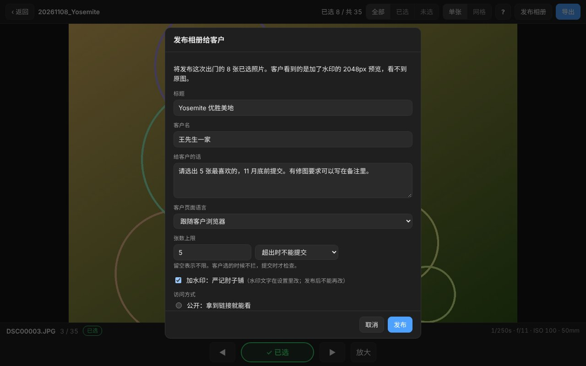
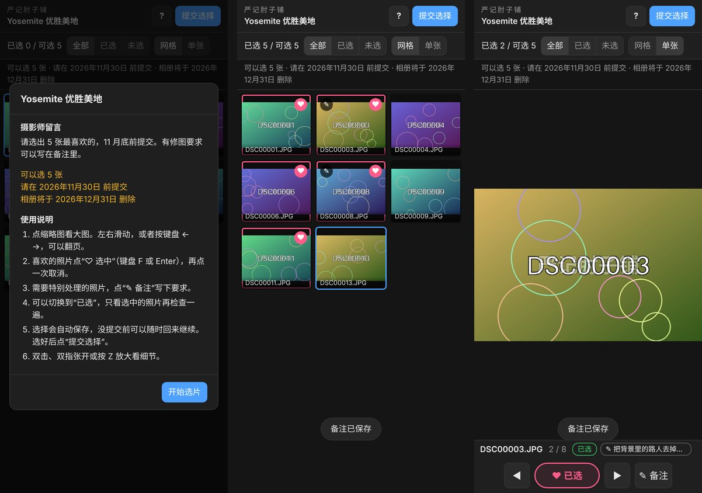
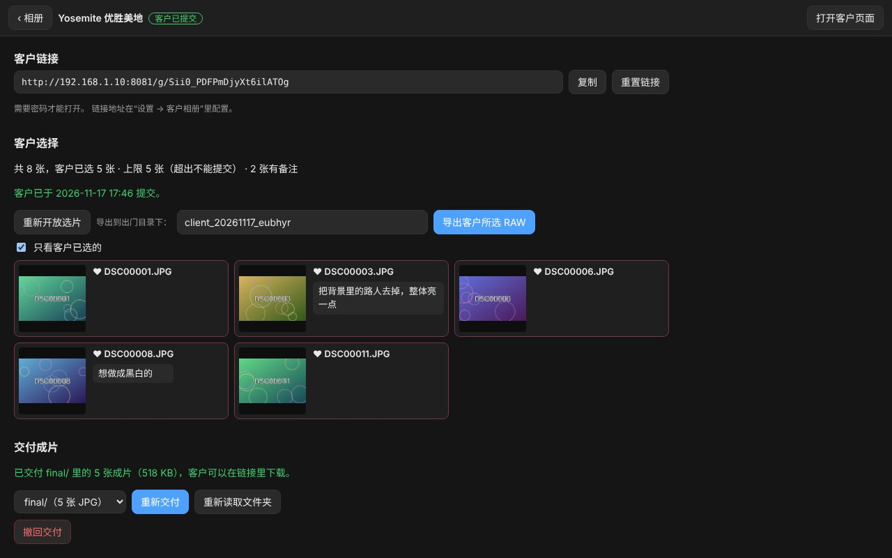

# 使用说明

## 首页

首页列出照片根目录下所有出门目录。

### 文件夹名

建议按 `yyyymmdd_主题` 命名，比如 `20261108_Yosemite`、`20261025_南湖露营`。首页会据此显示日期和主题。
不符合这个格式的文件夹照常显示，日期一栏写“未识别日期”，按日期排序时排在最后。

### 每个文件夹显示的信息

- **张数**：打开过的是实际参与筛选的张数；没打开过的写“约 N 张”，按 `jpg/` 里的 JPG 文件数估算。
- **已选**：选取了多少张。
- **状态**：
  - **未打开**：从没在 rawpick 里打开过；
  - **筛选中**：打开过，`select/` 里还没有文件；
  - **已导出 N**：`select/` 里有 N 个文件。不管这些文件是不是 rawpick 导出的，只要有就算。
- **上次导出**：最近一次用 rawpick 导出的时间。

### 搜索、筛选、排序、视图

| 工具 | 说明 |
| --- | --- |
| 搜索框 | 按主题或文件夹名模糊匹配 |
| 年份 | 只看某一年（按文件夹名里的日期） |
| 状态 | 全部 / 未打开 / 筛选中 / 已导出 |
| 排序 | 日期新→旧（默认）、日期旧→新、主题 A→Z、照片张数多→少 |
| 视图 | 卡片，或列表（一行一个，适合文件夹多的时候） |

**排序和视图会记在当前设备上**，电脑和 iPad 可以各用各的。搜索和筛选只在这次打开期间保留，刷新浏览器后恢复默认。

### 什么时候刷新

首页在以下时候重新读取文件夹：

- 进入首页时，包括从筛选界面点“返回”；
- 浏览器标签页重新回到前台时，比如刚在 Windows 上拷完照片，切回浏览器就能看到；
- 点右上角的“刷新”。

每个文件夹的张数和 `select/` 文件数都有缓存，目录没有变化时不会重新读，文件夹多、硬盘在休眠时也不慢。

### 提示条

如果有文件夹改名或移动后标记对不上，首页顶部会出现一条黄色提示，点“去处理”进入设置页（见下文“找回标记”）。

## 筛选

### 标记

只有两种状态：**已选**和**未选**，默认未选。选取或取消后自动跳到下一张。

- 选取和取消是两个独立的键，连续快速操作时多按一下不会把状态又翻回去。
- 触屏上底部的大按钮是切换：未选时点一下变已选，已选时点一下变未选，同样自动跳到下一张。
- 每次标记立即保存到服务器。保存失败时状态会恢复，并弹出提示。

### 过滤与二次筛选

顶栏的过滤器有三档：**全部 / 已选 / 未选**，顶栏始终显示“已选 N / 共 M”。

在“已选”或“未选”视图里改了某张照片的状态，它**不会立刻消失**，而是变灰并标上“已不在当前过滤中”，
这样当前位置不会跳。**再点一次当前的过滤器**，或者切换到别的过滤器，列表才会刷新。

典型的二次筛选：第一遍在“全部”里快速挑，第二遍切到“已选”，把不想要的取消掉，最后再点一次“已选”收紧列表。

### 视图

- **单张**：大图，底部显示文件名、序号、快门 / 光圈 / ISO / 焦距，以及“已选”“缺 RAW”等标记。
- **网格**：每个格子大小相同，横幅和竖幅都完整显示在格子里。已选的带绿色对勾，缺 RAW 的在文件名后标出。
  网格里同样可以用键盘选取和取消，点缩略图进入单张。

### 放大查焦

- 键盘：`Z` 或空格切换 100%，`Esc` 退出。
- 鼠标：单击图片，以点击的位置为中心放大；放大后拖动平移，单击退出。
- 触屏：双指张开或双击放大，单指拖动平移；双指捏合或双击退出。

放大时加载的是原始 JPG（通常 10~20MB），在 iPad 的 Wi-Fi 下可能要一两秒。

### 下载原图

单张视图底部有“下载”按钮，下载当前这张照片的原始 JPG（原分辨率，和相机里的文件一模一样），文件名不变。
翻到哪张就下载哪张；网格视图里没有这个按钮，先点缩略图进入单张。下载只读照片目录，不会改动任何文件。

- 电脑：存到浏览器的下载文件夹。
- iPad、iPhone（Safari）：会先问是否下载，文件存到“文件”App 的“下载”文件夹。
  想存进“照片”，在“文件”里打开它，点分享 →“存储图像”。

### 在手机上

手机屏幕窄，顶栏只留一行：返回、文件夹名、“已选 N / 共 M”、`⋯` 和“导出”。
过滤（全部 / 已选 / 未选）、视图（单张 / 网格）、操作说明和“发布相册”收在 `⋯` 菜单里，点完自动收起；
有扫描异常时 `⋯` 上会有一个小黄点，菜单里能看到“异常 N”。
其他操作和 iPad 一样：左右滑动翻页，点底部大按钮选取，双击或双指张开放大。

### 断点续筛

当前看到第几张会自动保存到服务器。离开页面、刷新或关闭标签页时会立刻保存。
下次在任何设备上打开同一个出门目录，都会回到这张。

## 快捷键

默认分左手、右手两套，每一套都能单手完成全部操作：

| 操作 | 左手 | 右手 | 生效范围 |
| --- | --- | --- | --- |
| 上一张 / 下一张 | `A` / `D` | `←` / `→` | 单张、网格 |
| 选取，然后跳到下一张 | `F` | `Enter` | 单张、网格 |
| 取消选取，然后跳到下一张 | `Q` | `Backspace` | 单张、网格 |
| 100% 放大 / 退出放大 | `Z` | 空格 | 仅单张 |
| 上移一行 / 下移一行 | `W` / `S` | `↑` / `↓` | 仅网格 |
| 切换到网格视图 | `G` | — | 单张、网格 |
| 切换到单张视图 | `E` | — | 单张、网格 |
| 显示操作说明 | `?` | — | 单张、网格 |
| 退出放大、关闭弹窗 | `Esc`（固定） | — | — |

- 按的是**物理按键**，开着大写锁定或切到中文输入法时，字母键照样能用。
- 在筛选界面里 `Backspace` 一律被拦截，不会让浏览器后退。
- 顶栏的 `?` 按钮或键盘上的 `?` 打开**操作说明**，里面列出键盘（跟随你的设置）、鼠标和触屏的全部操作。

## 设置

首页右上角的“⚙ 设置”。设置保存在服务器上，所有设备共用。

### 快捷键

- 每个操作可以绑定多个键。点“+ 添加”，再按下想用的键；按 `Esc` 取消。
- 点键名旁边的 × 删除这个键。
- 同一个键在同一个视图里只能对应一个操作。把已经在用的键加给另一个操作时，会自动从原来的操作上移走，并提示你。
  “放大”只在单张视图生效，“上移 / 下移”只在网格生效，所以它们可以共用同一个键。
- `Esc` 和 `Tab` 不能设为快捷键。
- 修改立即保存。“恢复默认快捷键”回到上面表格里的默认设置。

### 找回标记

rawpick 按**文件夹名**记录每个文件夹的标记、看到第几张和导出记录。文件夹改名或移动后，旧记录就对不上新文件夹了。
磁盘上的文件不受影响：照片和 `select/` 都还在原处，只是 rawpick 会把改名后的文件夹当成一个新文件夹，所有照片显示为未选。

下面把对不上的旧记录叫做**孤立记录**，把磁盘上有、但从没在 rawpick 里打开过的文件夹叫做**空白文件夹**。

**自动关联**（默认打开，可以在这里关掉）：每次首页刷新时，
如果一条孤立记录和一个空白文件夹的照片完全相同（文件名一样，张数自然也一样），
而且双方都只匹配到对方这一个，就自动把记录转过去，并在首页提示“已自动关联标记：旧名 → 新名”。
照片有增减、或者能匹配到好几个文件夹时，不会自动处理。

**手动关联**：设置页列出所有孤立记录，以及它的照片数、已选数、上次导出时间。
为它在下拉框里选一个空白文件夹，点“关联”。下拉框里会注明每个文件夹和原记录有多少张同名照片，方便判断。

- 同名的照片保留标记；新增的照片当作未选；已经不存在的照片的标记丢弃。
- 只能关联到空白文件夹，不会合并两个都已经有标记的文件夹。
- 相机的文件编号会重复，不同的出门也可能有大量同名照片，选之前请看清文件夹名。

**删除记录**：文件夹是真的删掉了的话，点“删除这条记录”，它的标记、导出记录和预览缓存都会删除。磁盘上的文件不受影响。

找回标记只修改 rawpick 自己的数据库，不会动磁盘上的任何文件。

### 客户相册

- **水印文字**：加在客户看到的预览图中间，半透明，默认“严记肘子铺”。也作为工作室名显示在客户页面顶部。
  只影响以后发布的相册。
- **客户访问地址**：生成客户链接用的地址。留空时用“你现在访问 rawpick 的地址 + 客户端端口”，
  比如 `http://192.168.51.67:8071`，只有家里局域网能打开。以后接上域名和隧道，填成 `https://你的域名`。

### 关于

显示版本号、照片根目录、数据目录、客户端端口和水印字体。

## 导出

点右上角的“导出”，先看清单，确认后才开始拷贝。只拷 RAW，目标是 `<出门目录>/select/`，不存在时自动创建。

| 情况 | 处理 |
| --- | --- |
| 已选，`select/` 里没有 | 拷贝 |
| 已选，`select/` 里有同名且大小相同 | 跳过 |
| 已选，`select/` 里有同名但大小不同 | 不覆盖，列为冲突 |
| 已选，但没有对应的 RAW | 列为“缺 RAW” |
| `select/` 里有，但现在未选 | **不删除**，列出来提醒你自己处理 |

- 拷贝在服务器上完成，关掉浏览器或面板都不会中断。重新打开导出面板会接着显示进度。
- 拷贝的文件保留原始修改时间。
- 每个文件先写成 `.文件名.part`，写完、校验大小后才改成正式名字，中途出错不会留下残缺的文件。
- 重复导出是安全的：已经拷过的会被跳过。

## 客户相册

把粗筛好的照片发给客户选：客户在手机或电脑上选片、写备注、提交；你把客户选中的 RAW 导出修图，修好后把成片交给客户下载。

> 第一期（0.3.0）客户链接只在家里局域网能打开，可以先用自己的手机试。给外面的客户用，要等第二期接上域名和隧道。

### 发布

1. 在筛选界面把要给客户看的照片选上（就是平常的粗筛）。
2. 点顶栏的“发布相册”，填写：

| 项 | 说明 |
| --- | --- |
| 标题、客户名 | 显示在客户页面。标题默认是文件夹名里的主题 |
| 给客户的话 | 显示在客户第一次打开时的说明里，比如“请选出 20 张，月底前提交” |
| 客户页面语言 | 默认跟随客户的浏览器（中文或英文），也可以指定 |
| 张数上限 | 可以不填。客户选的时候不拦，提交时检查；超出时“不能提交”或“提醒后仍可提交”，二选一 |
| 加水印 | 默认加。发布后不能再改 |
| 访问方式 | 公开（拿到链接就能看），或者需要密码 |
| 截止日期 | 可以不填。过了这一天，客户还能看，但不能再改选择、不能提交 |
| 自动删除日期 | 可以不填。到期删除相册文件，客户链接失效；客户的选择和备注会保留 |

3. 点“发布”，进入相册详情页。后台生成预览期间显示进度，生成完客户才能打开。
4. 复制“客户链接”发给客户；设了密码的话把密码一起发过去。

发布的是一份**快照**：之后再改标记、改原文件，客户看到的都不变。一个出门目录可以发布多个相册，每个相册有自己的编号和链接。

### 客户看到的

- 第一次打开显示你的留言、可选张数、截止和自动删除日期，以及操作方法。之后点右上角 `?` 可以再看。
- 默认先看网格，点一张进入大图。左右滑动翻页，双击或双指张开放大。
- 点“♡ 选中”选择，再点一次取消。点“✎ 备注”写修图要求。
- 选择和备注随时自动保存，没提交前可以分几次选完，换设备也能接着选。
- 选好后点“提交选择”。提交后不能再修改，页面顶部会提示“如需修改请联系摄影师”。
- 有成片时多一个“成片”标签：可以一张张下载，也可以“全部下载”成一个 zip。

### 相册详情页

首页右上角“客户相册”列出所有相册，点进去是详情页：

- **客户链接**：复制；“重置链接”会生成新链接，旧链接马上失效，客户的选择不受影响。
- **客户选择**：已选张数、有备注的张数、提交时间，以及每张选中照片的缩略图和备注。
  客户提交后想改，点“重新开放选片”。
- **导出客户所选 RAW**：默认导出到 `<出门目录>/client_<发布日期>_<相册编号>/`，可以改名。
  规则和导出到 `select/` 一样：只增不删，已有的跳过，同名不同大小的不覆盖。
- **交付成片**：修好图后，把成片 JPG 导出到这次出门目录下的一个文件夹（比如 `final/`），
  在这里选中它，点“发布成片”。列表里排除了 `jpg`、`raw`、`select`，并显示每个文件夹里的 JPG 张数。
  成片是原图，不加水印。可以“重新交付”（替换成另一个文件夹的内容）或“撤回交付”。
- **设置**：发布时的设置（水印除外）都可以改。改密码后，客户需要重新输入。
- **删除相册**：删除相册文件和这条记录，包括客户的选择和备注。照片目录不受影响。

到了自动删除日期，相册文件会被删除，客户链接失效；详情页里客户的选择和备注还在，RAW 照样能导出。

## 扫描发现的异常

顶栏有黄色的“异常 N”按钮时，点开可以看到：

- **只有 RAW、没有 JPG**：这些照片无法预览，不参与筛选；
- **同一文件名有多个文件**：例如同时有 `DSC00007.JPG` 和 `DSC00007.jpeg`，无法确定配对，不参与筛选；
- **被忽略的子目录**：`jpg/` 或 `raw/` 里的子目录不会被扫描。

`jpg/`、`raw/` 里的其他文件（如 `.xmp`）会被直接忽略，不算异常。

## 什么时候会重新扫描照片

每次打开一个出门目录都会重新扫一遍：

- 新增的照片加入列表；
- 删除的照片从列表移除；
- 修改过的 JPG 会重新生成预览；
- 已有的标记都保留。
